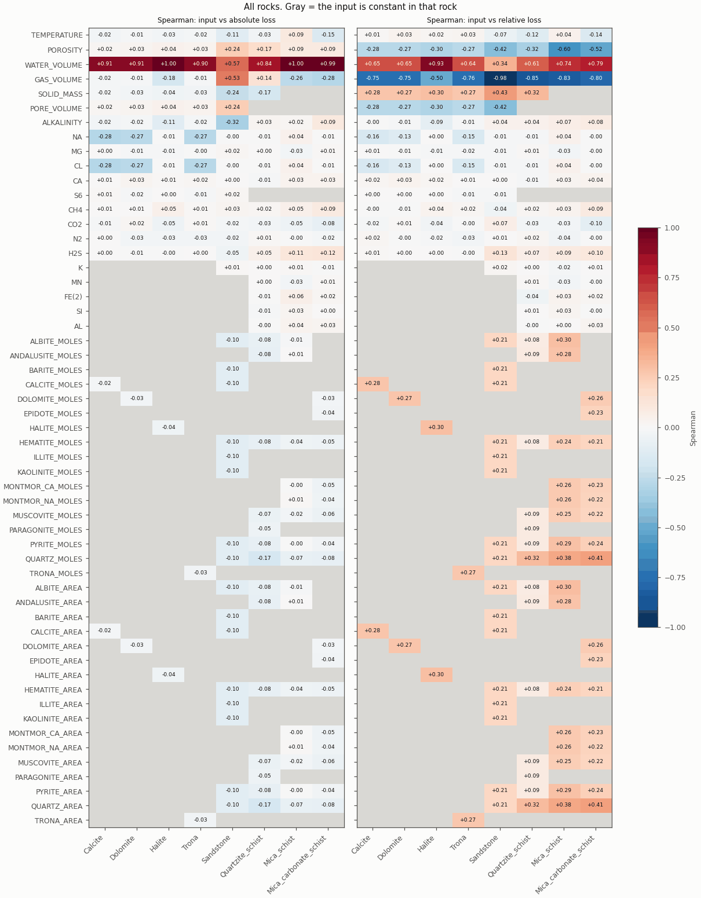
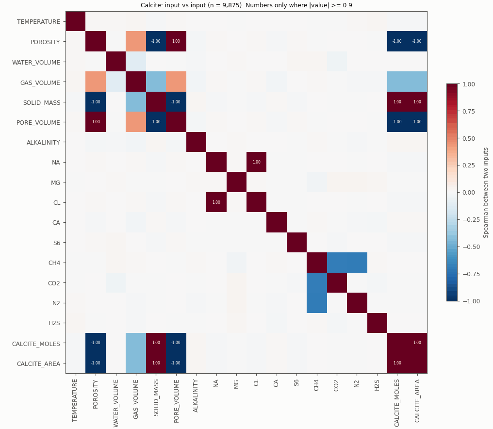
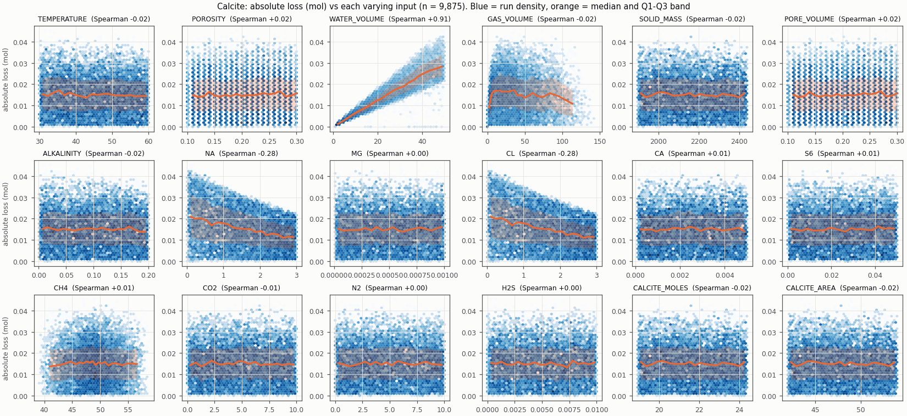
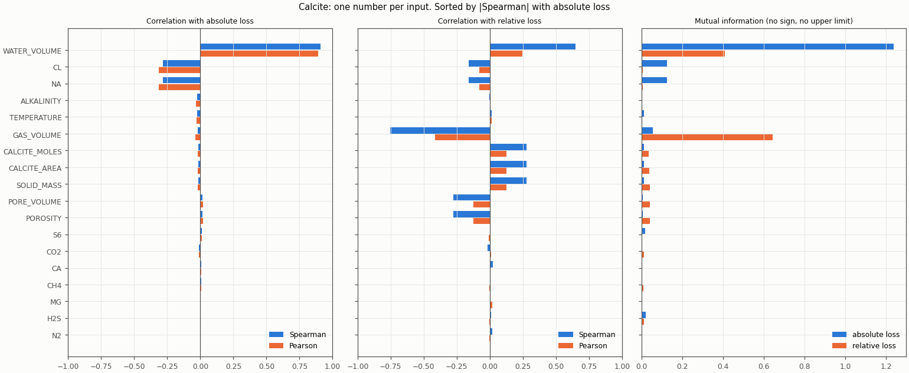
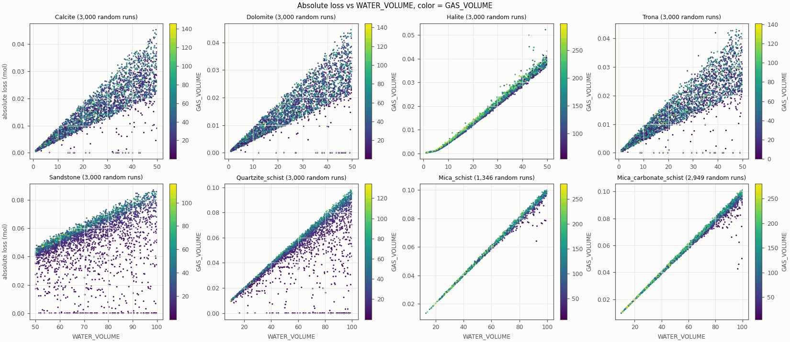
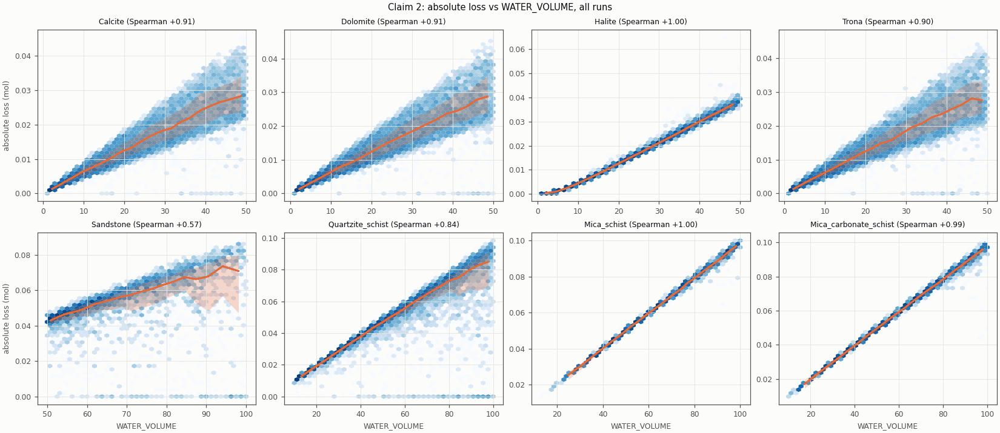
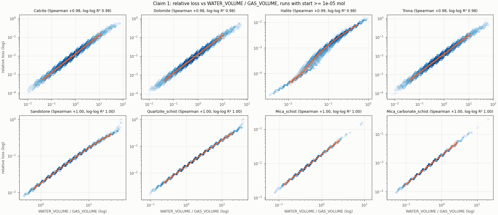
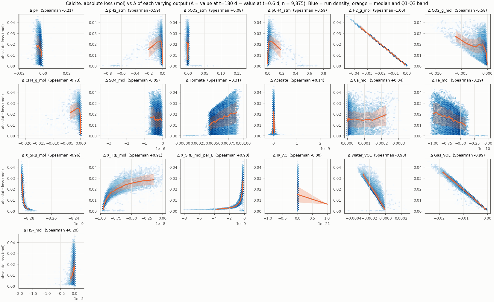

# Feature relations: step by step

Date: 2026-11-09. Data: the cached 55,122 runs of 8 rocks.
All numbers come from the real data. This lesson shows the relations only.
It does not give conclusions.

## Progress

- [ ] Step 1: One run is one row
- [ ] Step 2: Rank
- [ ] Step 3: Spearman
- [ ] Step 4: The figures
- [ ] Step 5: The earlier claim and the full data
- [ ] Step 6: Loss vs the change of each output
- [ ] Check questions

---

## Definitions

- **Absolute loss** = start − end, in mol. Start is H2_g_mol at t = 0.6
  days. End is H2_g_mol at t = 180 days.
- **Relative loss** = absolute loss / start.
- The relative loss figures do not use the 456 runs with a start below
  1e-26 mol. No run has a start between 1e-26 and 1e-5 mol. Thus each limit
  in this range removes the same runs. The figures use 1e-5 mol.

---

## Step 1: One run is one row

Each run has two files. This is Calcite run 850.

The input file (`data/v2_eight_rocks/Calcite/input/850_Input.txt`) has one
value for each condition:

```
{TEMPERATURE} 56.31
{WATER_VOLUME} 41.30
{GAS_VOLUME} 30.59
{NA} 2.9675
...
```

The output file has 301 rows, one row for each time step. It has no
temperature column.

| Time (days) | H2_g_mol |
|---|---|
| 0.6 | 1.447974 |
| 180 | 1.429849 |

```
absolute loss = 1.447974 − 1.429849 = 0.018125 mol
```

Thus one run gives one row for this lesson: the input values and one loss
value. The figures compare the runs with each other. They do not compare
the time steps.

---

## Step 2: Rank

A **rank** is a position in a sorted list. Sort the values from the
smallest to the largest. The smallest value gets rank 1.

Five Calcite runs:

| Run | Absolute loss (mol) | Rank |
|---|---|---|
| 850 | 0.01812 | 5 |
| 1793 | 0.00526 | 1 |
| 1812 | 0.00527 | 2 |
| 2367 | 0.00670 | 3 |
| 8105 | 0.01346 | 4 |

The rank keeps the order only. It does not keep the distance between the
values. For example, 0.00526 and 0.00527 get ranks 1 and 2. 0.00670 and
0.01346 get ranks 3 and 4.

---

## Step 3: Spearman

**Spearman** (Spearman rank correlation, ρ) is one number from −1 to +1.
It compares the ranks of an input with the ranks of the loss.

- **+1:** when the input increases, the loss always increases.
- **−1:** when the input increases, the loss always decreases.
- **About 0:** the order of the loss does not follow the input.

Sort the same five runs by WATER_VOLUME. Then read the rank of the loss:

| Run | WATER_VOLUME | Rank of loss |
|---|---|---|
| 2367 | 8.97 | 3 |
| 1793 | 9.74 | 1 |
| 1812 | 10.08 | 2 |
| 8105 | 31.65 | 4 |
| 850 | 41.30 | 5 |

Sort the same five runs by TEMPERATURE:

| Run | TEMPERATURE | Rank of loss |
|---|---|---|
| 2367 | 31.85 | 3 |
| 8105 | 43.55 | 4 |
| 1793 | 48.06 | 1 |
| 850 | 56.31 | 5 |
| 1812 | 59.60 | 2 |

The formula (for values without ties):

```
ρ = 1 − 6 · Σd² / (n · (n² − 1))
d = rank of input − rank of loss, for each run

WATER_VOLUME:  d = 0, 1, 1, −2, 0    Σd² = 6    ρ = 1 − 36/120  = +0.7
TEMPERATURE:   d = −1, 2, 3, −2, −2  Σd² = 22   ρ = 1 − 132/120 = −0.1
```

The figures use the same calculation on all runs of a rock (for example,
9,875 Calcite runs).

Two more scores appear in the bar figures:

- **Pearson** (r) uses the values, not the ranks. It is +1 or −1 only when
  the points are on a straight line.
- **Mutual information** is 0 or more. It has no sign and no upper limit.
  It can also show a relation that goes up and then down.

Documentation:

- https://docs.scipy.org/doc/scipy-1.17.0/reference/generated/scipy.stats.spearmanr.html
- https://docs.scipy.org/doc/scipy/reference/generated/scipy.stats.pearsonr.html
- https://scikit-learn.org/1.8/modules/generated/sklearn.feature_selection.mutual_info_regression.html

---

## Step 4: The figures

### 4.1 Overview: Spearman for each rock and each input



How to read the plot:

1. Each column is one rock. Each row is one input.
2. The number in a cell is the Spearman value of that input and the loss.
3. The left panel uses the absolute loss. The right panel uses the relative
   loss.
4. Red is a positive value. Blue is a negative value. White is about 0.
5. A gray cell shows an input that is constant in that rock.

The number of varying inputs (2 or more unique values) in each rock:

| Rocks | Varying inputs |
|---|---|
| Calcite, Dolomite, Halite, Trona | 18 |
| Sandstone, Quartzite_schist | 33 |
| Mica_schist, Mica_carbonate_schist | 34 |

### 4.2 Input vs input



How to read the plot:

1. The rows and the columns are the varying inputs of one rock.
2. A cell is the Spearman value of two inputs. It does not use the loss.
3. A number is in the cell only when the absolute value is 0.9 or more.
4. Two inputs with a value of ±1.00 change together in all runs. A figure
   cannot separate their relation to the loss.

### 4.3 Loss vs each input



How to read the plot:

1. Each panel is one input. The x-axis is the input value. The y-axis is
   the loss.
2. A blue hexagon holds the runs in that area. A darker hexagon holds more
   runs. The color scale is logarithmic.
3. The runs are put in 20 groups by the input value. Each group has about
   the same number of runs.
4. The orange line is the median loss of each group.
5. The orange band is the range from Q1 to Q3. Q1 is the value with 25 %
   of the runs below it. Q3 is the value with 75 % of the runs below it.
6. The panel title gives the Spearman value.

The relative loss figures (`2_panels_rel_*`) use a logarithmic y-axis.

### 4.4 One number for each input



How to read the plot:

1. The left panel shows Spearman (blue) and Pearson (orange) with the
   absolute loss.
2. The middle panel shows the same scores with the relative loss.
3. The right panel shows the mutual information. Its scale is different.
4. The rows are sorted by the absolute Spearman value with the absolute
   loss.

### 4.5 Two inputs at the same time



How to read the plot:

1. Each dot is one run. Each panel shows a maximum of 3,000 random runs.
2. The x-axis is WATER_VOLUME. The y-axis is the absolute loss.
3. The color is GAS_VOLUME. Yellow is a high value. Dark purple is a low
   value.

### 4.6 All figures

| Figure | Files |
|---|---|
| Input vs input | `1_input_heatmap_<n>_<rock>.png` |
| Absolute loss vs each input | `2_panels_abs_<n>_<rock>.png` |
| Relative loss vs each input | `2_panels_rel_<n>_<rock>.png` |
| Spearman, Pearson, mutual information | `3_bars_<n>_<rock>.png` |
| Spearman overview | `3_overview_spearman.png` |
| Claim 2 | `4a_claim_absolute_vs_water.png` |
| Claim 1 | `4b_claim_relative_vs_ratio.png` |
| Two inputs | `5_scatter_colored.png` |

The number `<n>` gives the rock: 1 Calcite, 2 Dolomite, 3 Halite, 4 Trona,
5 Sandstone, 6 Quartzite_schist, 7 Mica_schist, 8 Mica_carbonate_schist.
All files are in `figures/feature_relations/inputs/`.

---

## Step 5: The earlier claim and the full data

An earlier agent wrote two claims in `ASAMA1_FIZIBILITE.md`. This file is
only in the git ref `7d4dfe01d`. Its scripts are deleted.

- Claim 1: log(relative loss) vs log(WATER_VOLUME / GAS_VOLUME) has
  R² = 0.97 (Calcite) and 0.98 (Dolomite). It used 200 runs for each rock.
- Claim 2: the absolute loss vs WATER_VOLUME has a Spearman value of 0.85
  to 1.0, and about 0.6 in Sandstone. It used 1,000 runs for each rock.





The same scores on all runs:

| Rock | Runs | Spearman, absolute loss vs WATER_VOLUME | Runs (relative) | Spearman, relative loss vs ratio | log-log R² |
|---|---|---|---|---|---|
| Calcite | 9,875 | +0.908 | 9,828 | +0.984 | 0.976 |
| Dolomite | 9,882 | +0.907 | 9,824 | +0.984 | 0.976 |
| Halite | 9,425 | +0.998 | 9,425 | +0.994 | 0.977 |
| Trona | 9,899 | +0.905 | 9,838 | +0.985 | 0.976 |
| Sandstone | 3,677 | +0.567 | 3,563 | +1.000 | 0.997 |
| Quartzite_schist | 8,069 | +0.836 | 7,893 | +1.000 | 0.999 |
| Mica_schist | 1,346 | +0.996 | 1,346 | +1.000 | 1.000 |
| Mica_carbonate_schist | 2,949 | +0.994 | 2,949 | +1.000 | 1.000 |

NOTE: 3 runs have GAS_VOLUME = 0 (1 Dolomite, 2 Trona). These are the same
3 runs that have a start of exactly 0. The ratio figure does not use them.

---

## Step 6: Loss vs the change of each output

An input has one value for each run. An output has 301 values for each
run, one for each time step. A panel needs one x value for each run. Thus
the figures use the change of each output:

```
Δ output = value at t = 180 days − value at t = 0.6 days
```

The window is the same as the window of the loss. Example: the median pH
of all runs is 6.073 at t = 0.6 days and 6.082 at t = 180 days.



How to read the plot:

1. Each panel is one output. The x-axis is Δ of that output. The y-axis is
   the loss.
2. The hexagons, the orange line, and the orange band have the same
   meaning as in 4.3.
3. The panel title gives the Spearman value of Δ and the loss.
4. The relative loss figures (`2_panels_rel_*`) use a logarithmic y-axis.

NOTE: Δ H2_g_mol = end − start = −(absolute loss). This is true for each
run by definition. Thus the Δ H2_g_mol panel in the absolute loss figures
is a straight line with a Spearman value of −1.00.

NOTE: An output is a result of the simulation. It is not a value that the
input file sets.

These outputs have Δ = 0 in all runs of all rocks. The figures do not show
them: Ptot_atm, Fe(OH)3, SR_H2, SR_FOR, SR_AC.

The number of outputs with a varying Δ (2 or more unique values):

| Rock | Absolute loss figure | Relative loss figure |
|---|---|---|
| Calcite | 19 | 19 |
| Dolomite | 18 | 18 |
| Halite | 19 | 19 |
| Trona | 18 | 18 |
| Sandstone | 21 | 21 |
| Quartzite_schist | 21 | 20 |
| Mica_schist | 20 | 20 |
| Mica_carbonate_schist | 21 | 21 |

The script checks "varying" on the runs that each figure uses. In
Quartzite_schist, Δ IR_H2 changes only in runs with a start below 1e-5 mol.
The relative loss figure does not use these runs. Thus it does not show
Δ IR_H2.

| Figure | Files |
|---|---|
| Absolute loss vs Δ of each output | `outputs/2_panels_abs_<n>_<rock>.png` |
| Relative loss vs Δ of each output | `outputs/2_panels_rel_<n>_<rock>.png` |

---

## Check questions

1. What are the ranks of `[7, 2, 100]`?
2. Change 100 to 1,000,000. Do the ranks change?
3. Calcite run 1793 has start 0.060038 mol and end 0.054779 mol. What is
   the absolute loss?
4. POROSITY and PORE_VOLUME have a Spearman value of 1.00 in Calcite. Can a
   figure show which one of the two is related to the loss?

Answers:

1. ...
2. ...
3. ...
4. ...

---

NOTE: Temporary scripts made the figures in `figures/feature_relations/`.
The PNG files use a 256-color palette to make the files smaller. The EDA
plot module of this work stream will replace them.
