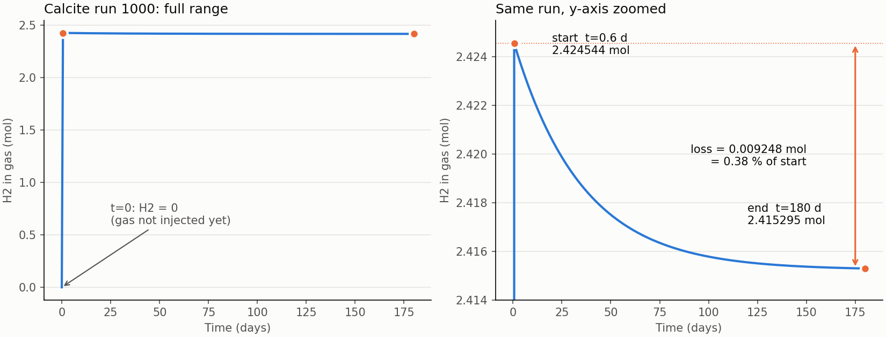
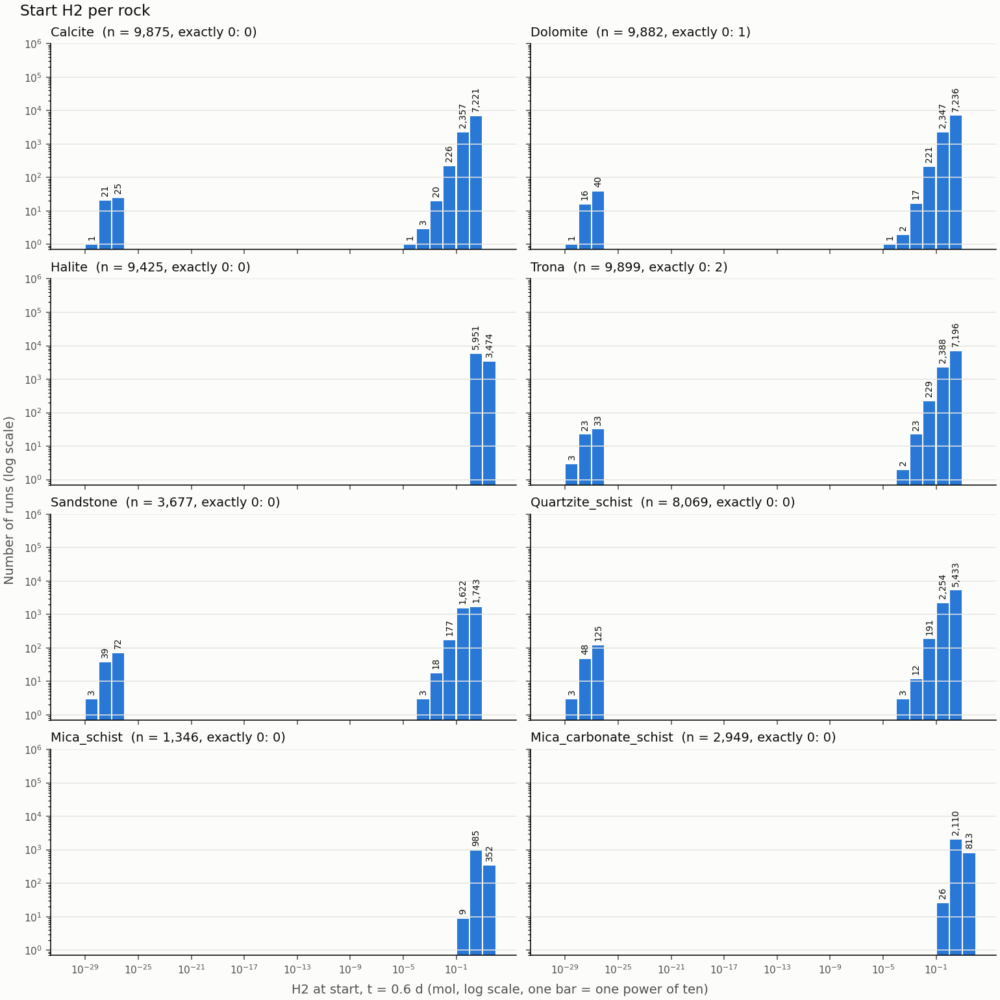
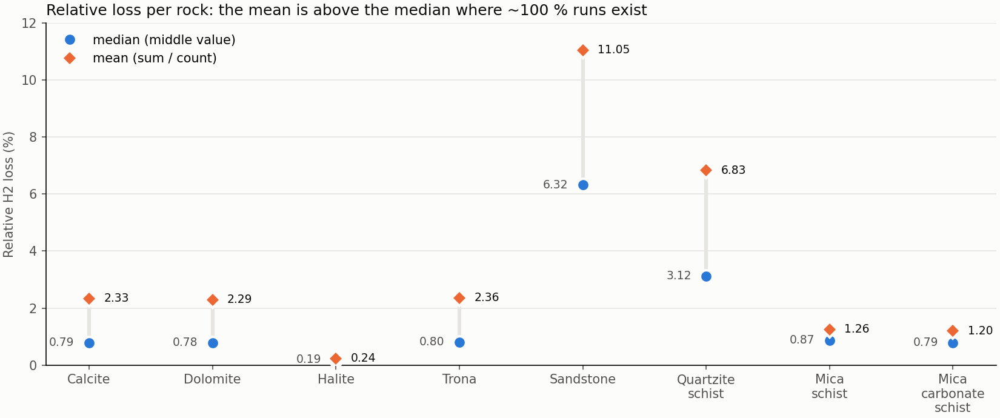

# H2 loss metrics: step by step

Date: 2026-11-08. Data: the cached 55,122 runs of 8 rocks.
All numbers come from the real data. This lesson shows the operations only.
It does not show code.

## Progress

- [ ] Step 1: One run is 301 numbers
- [ ] Step 2: Why the start is t=0.6
- [ ] Step 3: Absolute loss (one subtraction)
- [ ] Step 4: Relative loss (one division)
- [ ] Step 5: Problem case: a start value near zero
- [ ] Step 6: Do the operation on 55,122 runs at the same time
- [ ] Step 7: Mean or median?
- [ ] Open decisions
- [ ] Check questions

---

## Step 1: One run is 301 numbers

One run is 301 numbers. They show how the H2 amount changes with time.
This is Calcite run 1000:

| Index | Time (days) | H2 (mol) |
|---|---|---|
| 0 | 0.0 | 0.000000 |
| 1 | 0.6 | 2.424544 |
| 2 | 1.2 | 2.424385 |
| 3 | 1.8 | 2.424230 |
| 10 | 6.0 | 2.423212 |
| 50 | 30 | 2.419252 |
| 100 | 60 | 2.416941 |
| 200 | 120 | 2.415546 |
| 300 | 180 | 2.415295 |

- There are 301 time steps: 0, 0.6, 1.2, ... 180 days. The step is 0.6 days.
- H2 jumps up first. Then it decreases slowly. We measure this decrease.



- **Left plot:** the full run. The decrease is very small, so the line looks
  flat.
- **Right plot:** the same run with a zoomed y-axis. The orange arrow is the
  loss.

---

## Step 2: Why the start is t=0.6

These facts are confirmed on all 55,122 runs:

- At t=0, H2 is **0 in all runs**. The gas is not in the system yet.
- The maximum H2 value is at t=0.6 in 55,121 runs. Only 1 run is different.
- No run has an end value that is larger than its start value. There is no
  negative loss.

Thus:

- **Start = index 1 (t=0.6 days)**
- **End = index 300 (t=180 days)**

If t=0 is the start, each run shows an H2 gain. That result is wrong.

---

## Step 3: Absolute loss (one subtraction)

```
absolute loss = start − end
              = 2.424544 − 2.415295
              = 0.009248 mol
```

Meaning: how many mol of H2 went away in 180 days?

---

## Step 4: Relative loss (one division)

```
relative loss = absolute loss / start × 100
              = 0.009248 / 2.424544 × 100
              = 0.38 %
```

Meaning: which percent of the start H2 went away?

**Why do we need the two metrics?** The rocks start with different H2
amounts:

| Rock | Start | Absolute loss | Relative loss |
|---|---|---|---|
| Calcite run 1 | 1.82 mol | **0.0300 mol** | 1.65 % |
| Trona run 1 | 0.43 mol | 0.0144 mol | **3.36 %** |

- By absolute loss, Calcite loses 2 times more.
- By relative loss, Trona loses 2 times more.
- The order changes. Thus we keep the two metrics.

One example from each rock:

| Rock | Run | Start (mol) | End (mol) | Loss (mol) | Relative |
|---|---|---|---|---|---|
| Calcite | 1 | 1.8203 | 1.7903 | 0.0300 | 1.65 % |
| Dolomite | 1 | 3.0434 | 3.0162 | 0.0272 | 0.89 % |
| Halite | 1 | 14.1857 | 14.1852 | 0.0005 | 0.00 % |
| Trona | 1 | 0.4267 | 0.4123 | 0.0144 | 3.36 % |
| Sandstone | 1 | 0.0000 | 0.0000 | 0.0000 | 49.29 % (!) |
| Quartzite_schist | 1 | 2.8011 | 2.7085 | 0.0926 | 3.31 % |
| Mica_schist | 4 | 1.8982 | 1.8062 | 0.0920 | 4.85 % |
| Mica_carbonate_schist | 1 | 6.4840 | 6.4401 | 0.0439 | 0.68 % |

Step 5 explains the (!) mark on the Sandstone row.

---

## Step 5: Problem case: a start value near zero

If the divisor (the start value) is very small, the result becomes very
large. Sandstone run 1 is an example:

```
start    = 0.000000000000000000000000000697 mol   (6.97e-28)
end      = 0.000000000000000000000000000353 mol   (3.53e-28)
relative = 49 %   <- this value has no meaning
```

This run has almost no H2.

NOTE: I think that these values are numerical residue from the simulator.
This is inferred. It is not confirmed.

These numbers are confirmed on all runs:

| Case | Runs |
|---|---|
| Start is exactly 0 (division by zero gives NaN) | 3 |
| Start < 1e-6 mol | 456 |
| Start < 1e-3 mol | 471 |
| Start < 0.01 mol | 561 |
| Relative loss ≈ 100 % (all have start < 0.01 mol) | 9 |
| Typical start (median) | 2.47 mol |



How to read the plot:

1. Each panel shows one rock. The panel title gives the number of runs (n)
   and the number of runs with a start of exactly 0.
2. The start value is the H2_g_mol column, row 1 (t = 0.6 days), of each
   output file.
3. The x-axis is logarithmic. Each bar holds one power of ten. For example,
   the 1e-28 bar holds the start values from 1e-28 to 1e-27 mol.
4. The number on a bar is the number of runs in that range.
5. The y-axis is logarithmic. Each grid line is 10 times the line below it.
6. A log axis cannot show 0. The runs with a start of exactly 0 are only in
   the panel title.

The counts in the plot:

| Rock | Runs | Exactly 0 | 1e-29 to 1e-26 mol |
|---|---|---|---|
| Calcite | 9,875 | 0 | 47 |
| Dolomite | 9,882 | 1 | 57 |
| Halite | 9,425 | 0 | 0 |
| Trona | 9,899 | 2 | 59 |
| Sandstone | 3,677 | 0 | 114 |
| Quartzite_schist | 8,069 | 0 | 176 |
| Mica_schist | 1,346 | 0 | 0 |
| Mica_carbonate_schist | 2,949 | 0 | 0 |
| **All** | **55,122** | **3** | **453** |

No run in any rock has a start value between 1e-26 and 1e-5 mol.

**Recommendation:**

- Calculate the absolute loss for each run.
- Calculate the relative loss only when the start is ≥ 1e-6 mol. Write NaN
  for the other runs.
- Put the 1e-6 limit in the config file. Do not put it in the code.

---

## Step 6: Do the operation on 55,122 runs at the same time

The data is one table: 55,122 rows (runs) × 301 columns (time steps).

```
              column 1 (t=0.6)        column 300 (t=180)
run 0     →     1.8203        ...       1.7903
run 1     →     ...           ...       ...
...
run 55121 →     ...           ...       ...
                   │                        │
                   └────── subtract ────────┘
                               ↓
                 one list of 55,122 loss values
```

The Java equivalent:

```java
for (int i = 0; i < 55122; i++) {
    loss[i] = h2[i][1] - h2[i][300];
}
```

NumPy runs this loop in C, in one operation. Thus we do not write a Python
loop. The result is the same, and the speed is much higher.

---

## Step 7: Mean or median?

- **Mean:** add all numbers. Divide the sum by the count.
- **Median:** sort the numbers. Take the middle one.

A small example: `[1, 1, 1, 1, 100]`

- Mean = 104 / 5 = **20.8**. One extreme value pulls the mean up.
- Median = the middle of the sorted list = **1**.

The relative loss (%) in our data:

| Rock | Min | Median | Mean | Max |
|---|---|---|---|---|
| Calcite | 0.01 | 0.79 | 2.33 | 100 |
| Dolomite | 0.01 | 0.78 | 2.29 | 100 |
| Halite | 0.00 | 0.19 | 0.24 | 1.39 |
| Trona | 0.01 | 0.80 | 2.36 | 100 |
| Sandstone | 0.81 | 6.32 | 11.05 | 100 |
| Quartzite_schist | 0.14 | 3.12 | 6.83 | 100 |
| Mica_schist | 0.11 | 0.87 | 1.26 | 19.34 |
| Mica_carbonate_schist | 0.07 | 0.79 | 1.20 | 33.05 |



How to read the plot:

- The blue dot is the median. The orange diamond is the mean.
- A long gray line means that extreme values pull the mean up.
- Halite has no extreme value (max 1.39 %). Thus the two marks are almost at
  the same point.
- Sandstone has 100 % values. Its mean is almost 2 times its median.

Result: **We compare the rocks by the median.**

---

## Open decisions

1. **Start point:** t=0.6, or the maximum H2 value of each run?
   - The two give the same result in 55,121 of 55,122 runs.
   - Recommendation: **t=0.6**. It is fixed and simple.
2. **Limit for the relative loss:** 1e-6 mol.
   - Recommendation: use this value because of the natural gap in Step 5.

---

## Check questions

1. A run starts with 10 mol H2. At the end, 9.5 mol stays. What are the
   absolute loss and the relative loss?
2. Use t=0 as the start for Calcite run 1000. What is the absolute loss? Why
   is this result wrong?
3. A rock has 1000 runs. 990 runs lose 1 %. 10 runs lose 100 %. Which value
   is larger, the median or the mean?

Answers:

1. ...
2. ...
3. ...

---

NOTE: Temporary scripts made the figures in figures/. The EDA plot module
of this work stream will replace them.
