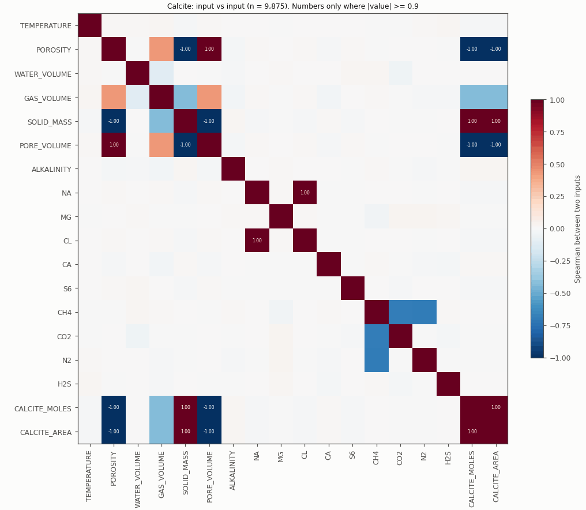

# Input generator: where the input relations come from

Date: 2026-11-09. Data: the cached 9,875 Calcite runs.
All numbers come from the real data or from the generator script.
This lesson shows the operations only. It shows code lines only where the
lesson needs a formula.

## Progress

- [ ] Step 1: A Python script makes the input files
- [ ] Step 2: The formulas in the script
- [ ] Step 3: The heatmap relations come from these formulas
- [ ] Step 4: Predict a correlation from a formula
- [ ] Step 5: The input file holds rounded values
- [ ] Step 6: What the script cannot tell
- [ ] Open questions
- [ ] Check questions

---

## Step 1: A Python script makes the input files

Each rock has one generator script:

```
data/v2_eight_rocks/<rock>/<rock>*.py
```

The Calcite script is `data/v2_eight_rocks/Calcite/Calcite_wat_sat.py`.
Its `work()` function does these steps for each run:

1. It selects random input values.
2. It writes the values to `input/<n>_Input.txt`.
3. It gives the values to PHREEQC.
4. It writes the PHREEQC result to `output/<n>_Output.txt`.

Thus the script is the source of the input values. PHREEQC is the source of
the output values, and of the H2 loss.

---

## Step 2: The formulas in the script

`U(a, b)` is a random number between a and b. Each value in the range has
the same probability. The script uses `np.random.uniform(a, b)` for it.

| Input | Formula in the script | Type |
|---|---|---|
| POROSITY | `por = U(0.1, 0.3)` | Random |
| PORE_VOLUME | `por × 1` (total volume = 1) | Copy of POROSITY |
| WATER_VOLUME | `U(1, 50)` | Random |
| GAS_VOLUME | `(por × 1000 − WATER) × U(0, 0.5)` | Uses POROSITY and WATER |
| SOLID_MASS | `(1 − por) × 2710` | Uses POROSITY |
| CALCITE_MOLES | `SOLID_MASS / 100.09e-3 × 1e-3` | Uses SOLID_MASS |
| CALCITE_AREA | `(6 / 100e-6) × (SOLID_MASS / 2710) × 1e-3` | Uses SOLID_MASS |
| TEMPERATURE | `U(30, 60)` | Random |
| ALKALINITY | `U(1e-3, 0.2)` | Random |
| NA | `U(1e-2, 3)` | Random |
| CL | `NA` | Copy of NA |
| CA | `U(1e-4, 5e-3)` | Random |
| MG | `U(1e-5, 1e-3)` | Random |
| S6 | `U(1e-4, 5e-2)` | Random |
| H2 | `1.1843` | Constant |
| CO2 | `U(0, 10)` | Random |
| N2 | `U(0, 10)` | Random |
| H2S | `U(0, 0.01)` | Random |
| CH4 | `(60 − 1.1843) − CO2 − H2S − N2` | Uses CO2, N2, H2S |

NOTE: The code comment for TEMPERATURE says "K". The range is 30 to 60.
The unit is not confirmed.

---

## Step 3: The heatmap relations come from these formulas



Each strong cell in the heatmap has one line in the script:

| Heatmap cell | Formula | Check on the data |
|---|---|---|
| POROSITY ~ PORE_VOLUME (+1) | `PORE_VOLUME = por × 1` | Equal in all runs |
| NA ~ CL (+1) | `CL = NA` | Equal in all runs |
| SOLID_MASS ~ POROSITY (−1) | `SOLID_MASS = (1 − por) × 2710` | Spearman −0.9988 |
| CALCITE_MOLES, CALCITE_AREA ~ SOLID_MASS (+1) | Both are SOLID_MASS × a constant | +1.00 in the heatmap |
| GAS_VOLUME ~ POROSITY (+0.43) | GAS uses `por` | Spearman +0.43 |
| GAS_VOLUME ~ WATER_VOLUME (−0.11) | GAS uses `− WATER` | Spearman −0.11 |
| CH4 ~ CO2 (−0.69), CH4 ~ N2 (−0.70) | `CH4 = constant − CO2 − N2 − H2S` | The sum of the 5 gases is 59.998 to 60.001 |
| WATER_VOLUME ~ other inputs (≈ 0) | WATER is a free random value | Range 1.0 to 49.99 |

Result: for the relations between inputs, the script is the best source. It
gives the exact formula. The heatmap only finds the same relations again
from the data.

---

## Step 4: Predict a correlation from a formula

The formula is `CH4 = constant − CO2 − N2 − H2S`.

1. CO2 and N2 come from the same range, 0 to 10. They have the same
   variance.
2. H2S is very small (0 to 0.01). Its effect is almost 0.
3. Thus the variance of CH4 has two equal parts: one from CO2 and one from
   N2.
4. CO2 explains half of the variance of CH4. Thus R² = 0.5.
5. The correlation is √0.5 ≈ 0.71. CH4 goes down when CO2 goes up. Thus the
   sign is minus.

| Value | CH4 ~ CO2 |
|---|---|
| Prediction from the formula | −0.707 |
| Pearson on the data | −0.703 |
| Spearman on the data | −0.695 |

The formula predicts the heatmap value before we look at the data.

---

## Step 5: The input file holds rounded values

The script writes each value with a fixed number of decimals. For example,
it writes POROSITY with `f"{por:.2f}"`, which keeps 2 decimals. The model
reads the file. Thus the model sees the rounded values, not the values in
the script.

These facts are confirmed on the 9,875 Calcite runs:

| Fact | Value |
|---|---|
| Unique POROSITY values | 21 (0.10, 0.11, ..., 0.30) |
| Max difference between SOLID_MASS and 2710 × (1 − POROSITY) | 13.55 kg |
| Runs where GAS > (POROSITY × 1000 − WATER) × 0.5 | 80 (max 2.3 L above the limit) |
| The same check with porosity from SOLID_MASS | 0 runs above the limit |
| Unique H2 values in the file | 1 (1.184, written with 3 decimals) |

Why:

1. SOLID_MASS uses the full value of `por`.
2. POROSITY in the file has a rounding error of 0.005 or less.
3. 2710 × 0.005 = 13.55. This is the max difference in the table.
4. The rounded POROSITY makes the GAS limit look wrong in 80 runs.

Result: SOLID_MASS keeps the porosity value with more precision than the
POROSITY column. We can see this only in the data. The script does not show
it.

---

## Step 6: What the script cannot tell

| Question | Source |
|---|---|
| Which inputs change together? | The script (exact formula) |
| What range does each input have? | The script |
| Which inputs change the H2 loss? | Not the script. PHREEQC makes the loss. We need the data figures. |

The script also shows the region where the model saw training data. For
Calcite:

- POROSITY: 0.1 to 0.3
- WATER_VOLUME: 1 to 50
- GAS_VOLUME: 0 to (POROSITY × 1000 − WATER) × 0.5
- CO2: 0 to 10
- N2: 0 to 10

NOTE: This region is important for the input optimization design. The
decision about how to use it is open.

---

## Open questions

1. The other 7 rocks have their own scripts. Their formulas and ranges are
   not checked yet. Earlier reports give a WATER range of 50 to 100 for
   Sandstone. This is inferred from the data. It is not checked in the
   script.
2. Is the script in `data/v2_eight_rocks/` the exact version that made the
   data? The Calcite checks in Step 3 and Step 5 agree with it. The other
   rocks are not checked.

---

## Check questions

1. The N2 range changes from 0–10 to 0–20. Does the correlation of CH4 and
   CO2 become stronger or weaker? Why?
2. Why does POROSITY have only 21 unique values?
3. Can the generator script tell which inputs decrease the H2 loss? Why?

Answers:

1. ...
2. ...
3. ...
